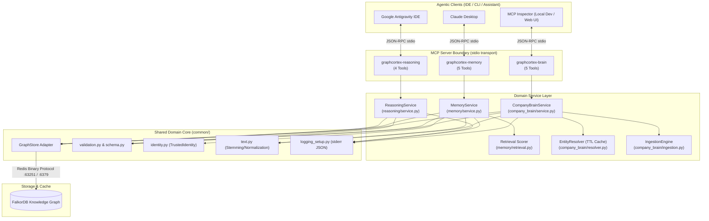
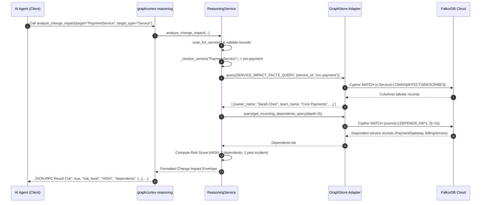
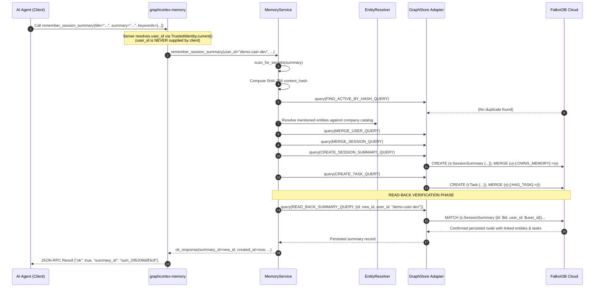
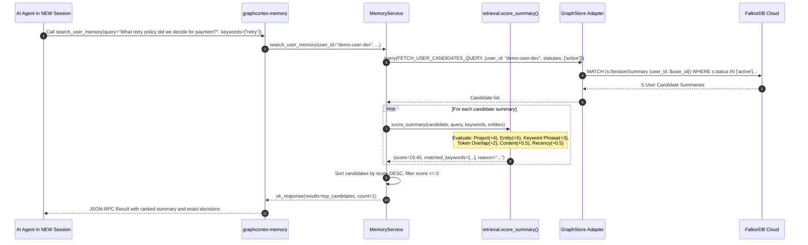
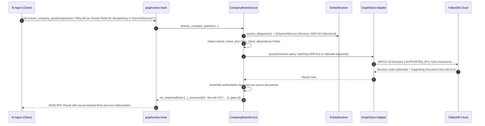

# GraphCortex: Comprehensive Architecture & File-Level Code Flow

[](https://www.python.org/downloads/)
[]()
[](https://modelcontextprotocol.io/)

This document provides an exhaustive, file-by-file technical breakdown of the entire **GraphCortex Platform & Autonomous Memory Engine**. It explains how every component functions, how data flows through the layers, why each file is decoupled into its specific role, and how the system guarantees security, deterministic retrieval, and protocol stability.

---

## Table of Contents

1. [Architectural Philosophy & Design Principles](#1-architectural-philosophy--design-principles)
2. [End-to-End System Topology](#2-end-to-end-system-topology)
3. [Deep File-by-File Breakdown](#3-deep-file-by-file-breakdown)
   - [3.1 Shared Domain Core (`src/graph_intelligence/common/`)](#31-shared-domain-core-srcgraph_intelligencecommon)
     - [`config.py`](#configpy)
     - [`errors.py`](#errorspy)
     - [`falkordb_client.py`](#falkordb_clientpy)
     - [`identity.py`](#identitypy)
     - [`ids.py`](#idspy)
     - [`logging_setup.py`](#logging_setuppy)
     - [`result_models.py`](#result_modelspy)
     - [`schema.py`](#schemapy)
     - [`text.py`](#textpy)
     - [`validation.py`](#validationpy)
   - [3.2 Graph Reasoning Engine (`src/graph_intelligence/reasoning/`)](#32-graph-reasoning-engine-srcgraph_intelligencereasoning)
     - [`queries.py`](#reasoning-queriespy)
     - [`service.py`](#reasoning-servicepy)
     - [`mcp_server.py`](#reasoning-mcp_serverpy)
   - [3.3 Autonomous Memory Engine (`src/graph_intelligence/memory/`)](#33-autonomous-memory-engine-srcgraph_intelligencememory)
     - [`queries.py`](#memory-queriespy)
     - [`retrieval.py`](#memory-retrievalpy)
     - [`service.py`](#memory-servicepy)
     - [`mcp_server.py`](#memory-mcp_serverpy)
   - [3.4 Corporate Brain & Knowledge Graph (`src/graph_intelligence/company_brain/`)](#34-corporate-brain--knowledge-graph-srcgraph_intelligencecompany_brain)
     - [`queries.py`](#company-brain-queriespy)
     - [`resolver.py`](#company-brain-resolverpy)
     - [`service.py`](#company-brain-servicepy)
     - [`ingestion.py`](#company-brain-ingestionpy)
     - [`mcp_server.py`](#company-brain-mcp_serverpy)
   - [3.5 Seeding & Reference Graph (`src/graph_intelligence/seed/`)](#35-seeding--reference-graph-srcgraph_intelligenceseed)
     - [`demo_data.json`](#seed-demo_datajson)
     - [`seed_company_graph.py`](#seed-seed_company_graphpy)
   - [3.6 Operational Scripts (`scripts/`)](#36-operational-scripts-scripts)
     - [`check_connection.py`](#scripts-check_connectionpy)
     - [`seed_demo.py`](#scripts-seed_demopy)
     - [`verify_seed.py`](#scripts-verify_seedpy)
     - [`reset_demo.py`](#scripts-reset_demopy)
     - [`spike_falkordb.py`](#scripts-spike_falkordbpy)
   - [3.7 Test Architecture (`tests/`)](#37-test-architecture-tests)
4. [End-to-End Request Lifecycles (Execution Traces)](#4-end-to-end-request-lifecycles-execution-traces)
   - [Trace 1: Blast-Radius Impact Analysis (`analyze_change_impact`)](#trace-1-blast-radius-impact-analysis-analyze_change_impact)
   - [Trace 2: Long-Term Memory Persistence (`remember_session_summary`)](#trace-2-long-term-memory-persistence-remember_session_summary)
   - [Trace 3: Cross-Session Deterministic Memory Retrieval (`search_user_memory`)](#trace-3-cross-session-deterministic-memory-retrieval-search_user_memory)
   - [Trace 4: Grounded Corporate Q&A (`answer_company_question`)](#trace-4-grounded-corporate-qa-answer_company_question)
5. [Cross-Cutting Concerns & Security Boundaries](#5-cross-cutting-concerns--security-boundaries)

---

## 1. Architectural Philosophy & Design Principles

The codebase is engineered around six fundamental design principles:

1. **Clean / Hexagonal Architecture (Ports and Adapters)**:
   - **Drivers / Frameworks (Outer Layer)**: Model Context Protocol (FastMCP) running over `stdio`.
   - **Adapters Layer**: [`GraphStore`](src/graph_intelligence/common/falkordb_client.py) adapts Redis/FalkorDB driver calls into clean Python dictionaries.
   - **Domain Services (Core Layer)**: Pure Python domain services ([`ReasoningService`](src/graph_intelligence/reasoning/service.py#L20-L481), [`MemoryService`](src/graph_intelligence/memory/service.py#L22-L288), [`CompanyBrainService`](src/graph_intelligence/company_brain/service.py#L18-L312)) contain all graph algorithms, scoring math, and business logic.
   - Domain logic has zero knowledge of MCP transports or JSON-RPC protocols.

2. **Strict Single Responsibility Principle (SRP)**:
   - Every file has a single reason to change:
     - MCP server files only define tool signatures, docstrings, and parameter validations.
     - Service files coordinate business logic and data aggregation.
     - Query files hold parameterized Cypher queries and query builders.
     - Common utilities isolate cross-cutting tasks (secret scanning, text normalization, identity resolution).

3. **Zero-Stdout Protocol Inviolability**:
   - MCP uses `stdin` and `stdout` for JSON-RPC 2.0 messages. Any unexpected text written to `stdout` (e.g. `print()`, unformatted logger output, banner greetings) desynchronizes the JSON-RPC framing and crashes the client connection.
   - The entire codebase routes structured JSON logging strictly to `stderr` via [`logging_setup.py`](src/graph_intelligence/common/logging_setup.py#L1-L80).

4. **Security by Isolation & Defense-in-Depth**:
   - **No Raw Cypher Execution**: Neither LLMs nor clients have access to arbitrary query execution (`no run_cypher`).
   - **Server-Side Identity Injection**: The `user_id` parameter is never exposed in any MCP tool schema. It is resolved exclusively on the server from trusted environment/process context via [`TrustedIdentity`](src/graph_intelligence/common/identity.py#L7-L15).
   - **Payload Secret Scanning**: Every text input passes through [`scan_for_secrets()`](src/graph_intelligence/common/validation.py#L31-L48) before hitting database queries.

5. **Deterministic Graph Scoring (No Vector Embeddings)**:
   - Long-term memory retrieval operates without vector databases, embedding APIs, or cosine similarity drift.
   - Instead, it uses multi-factor deterministic scoring: Project Match (+4), Entity Match (+5/entity, max 15), Keyword Phrase Match (+3/keyword, max 12), Token Overlap (+2/token, max 12), Content Overlap (+0.5/token, max 3), 1-Hop Graph Proximity (+2, max 4), Recency Decay (+0.0 to +0.5), and Superseded Penalty (-3.0).

6. **Driver Encapsulation**:
   - The official `falkordb` library is imported in exactly **one file** across the entire application: [`falkordb_client.py`](src/graph_intelligence/common/falkordb_client.py#L7-L8). No service, tool, script, or query builder interacts with driver primitives directly.

---

## 2. End-to-End System Topology



---

## 3. Deep File-by-File Breakdown

### 3.1 Shared Domain Core (`src/graph_intelligence/common/`)

#### [`config.py`](src/graph_intelligence/common/config.py)
- **Primary Responsibility**: Centralized, type-safe environment configuration management using Pydantic Settings.
- **Key Classes & Methods**:
  - `Settings`: Subclasses `BaseSettings`. Exposes properties such as `FALKORDB_HOST`, `FALKORDB_PORT`, `FALKORDB_USERNAME`, `FALKORDB_PASSWORD` (`SecretStr`), `FALKORDB_SSL`, `FALKORDB_GRAPH`, `DEMO_USER_ID`, `DEFAULT_PROJECT_ID`, and `LOG_LEVEL`.
  - `Settings.get_password_str()`: Safely unwraps `SecretStr` into a raw string or `None` without leaking credentials in string representations.
  - `get_settings()`: Cached lru-singleton provider reading from `.env` or system environment variables.
- **Why Separate?**: Eliminates scattered `os.getenv()` calls across the project, enforces configuration validation at startup, and protects sensitive secrets from accidental leakage in stack traces or logs.

#### [`errors.py`](src/graph_intelligence/common/errors.py)
- **Primary Responsibility**: Defines the enterprise exception hierarchy for domain errors.
- **Key Classes**:
  - `GraphIntelligenceError`: Root exception carrying a human-readable `message` and machine-readable `error_code`.
  - `DatabaseUnavailable`: Raised when FalkorDB is unreachable, times out, or experiences transient socket disconnection.
  - `ValidationError`: Raised when user input violates bounds, length limits, or secret detection rules.
  - `EntityNotFoundError`: Raised when a requested microservice, ADR, or entity cannot be resolved in the graph.
  - `UnauthorizedScopeError`: Raised when tenant isolation boundaries are violated.
  - `ConflictError`: Raised on version mismatches during concurrent memory updates.
  - `DepthLimitExceeded`: Raised if an agent requests traversal depths beyond allowed bounds.
- **Why Separate?**: Decouples underlying third-party driver errors (`redis.exceptions.ConnectionError`, `redis.ResponseError`) from domain logic, allowing consistent mapping to standardized JSON-RPC error payloads.

#### [`falkordb_client.py`](src/graph_intelligence/common/falkordb_client.py)
- **Primary Responsibility**: The **exclusive database gateway** for the entire system. Encapsulates all connection pooling, retry handling, header decoding, row transformation, index enforcement, and graph management.
- **Key Classes & Methods**:
  - `get_falkordb_connection() -> FalkorDB`: Lazy singleton connection factory with configurable socket and connection timeouts.
  - `GraphStore(graph_name: Optional[str])`: Scoped abstraction representing an active FalkorDB graph.
  - `GraphStore.query(cypher, params, retry_count=1) -> List[Dict[str, Any]]`:
    - Executes parameterized Cypher statements.
    - Decodes raw FalkorDB result headers (`result.header`) into UTF-8 string keys.
    - Maps tabular rows (`result.result_set`) into a clean list of Python dictionaries (`[{"column": "value"}]`).
    - Implements automatic connection recovery: if a socket or timeout error occurs, invalidates `self._graph` and retries cleanly.
    - Wraps raw exceptions in `DatabaseUnavailable`.
  - `GraphStore.ping() -> bool`: Verifies database health with `RETURN 1 AS ping`.
  - `GraphStore.ensure_indexes()`: Idempotently creates schema indexes for `id` across all defined labels, plus `user_id` and `status` for `SessionSummary`. Inspects existing indexes using `CALL db.indexes()` to avoid re-creation errors.
  - `GraphStore.delete_graph()`: Safely destroys or cleans graph contents (`MATCH (n) DETACH DELETE n`).
- **Data Flow**:
  ```
  Cypher String + Params Dict 
    ──> GraphStore.query() 
    ──> Driver Socket 
    ──> Raw Result (Headers + Columnar Arrays) 
    ──> Transformed List of Python Dicts
  ```
- **Why Separate?**: Driver isolation is a critical software design pattern. By restricting `falkordb` imports to this single file, any driver version upgrade, Redis protocol variation, or database engine swap requires modifications in exactly one place.

#### [`identity.py`](src/graph_intelligence/common/identity.py)
- **Primary Responsibility**: Server-side trusted caller identity resolution.
- **Key Classes & Methods**:
  - `TrustedIdentity(user_id: str)`: Immutable frozen dataclass encapsulating the active authenticated user context.
  - `TrustedIdentity.current() -> TrustedIdentity`: Factory method resolving the active user from trusted configuration (`DEMO_USER_ID`) or security context.
- **Why Separate?**: **Tenant Security Isolation**. In agentic workflows, LLMs must never be permitted to specify `user_id` as a tool argument. Exposing `user_id` allows prompt injection attacks where an agent is coerced into querying or modifying another engineer's private sessions. Separating identity resolution into its own trusted module guarantees that tenant identity is resolved strictly server-side.

#### [`ids.py`](src/graph_intelligence/common/ids.py)
- **Primary Responsibility**: Deterministic and unique entity identifier generation and timestamp formatting.
- **Key Functions**:
  - `new_id(prefix: str) -> str`: Generates clean, readable prefixed random IDs (e.g. `sum_295209b8f3c8`, `task_a1b2c3d4e5f6`, `sess_0192837465ab`).
  - `utcnow_iso() -> str`: Emits timezone-aware ISO 8601 UTC timestamps (e.g. `2026-10-21T15:30:00.000000+00:00`).
- **Why Separate?**: Eliminates ad-hoc UUID slicing across different services, ensures standard prefix conventions across node labels, and guarantees consistent UTC ISO formatting across all graph nodes.

#### [`logging_setup.py`](src/graph_intelligence/common/logging_setup.py)
- **Primary Responsibility**: Safe, structured telemetry formatting streaming exclusively to `sys.stderr`.
- **Key Classes & Functions**:
  - `StderrJsonFormatter`: Formats standard Python logging records into single-line JSON strings (`timestamp`, `level`, `message`, `op_id`, `tool`, `duration_ms`, `status`).
  - `get_logger(name) -> logging.Logger`: Factory returning a non-propagating logger wired strictly to `sys.stderr`.
  - `log_operation(tool_name: str)`: Context manager wrapping MCP tool invocations. Automatically records operation duration in milliseconds, assigns a correlation `op_id`, traps error codes, and emits structured audit logs without leaking input parameters or sensitive text.
- **Why Separate?**: MCP stdio protocol protection. In an MCP stdio server, standard output (`sys.stdout`) is strictly reserved for JSON-RPC 2.0 frames. If any internal component writes unformatted text or debug statements to stdout, the client protocol parser desynchronizes and aborts. Isolating logging ensures that stdout remains completely pure.

#### [`result_models.py`](src/graph_intelligence/common/result_models.py)
- **Primary Responsibility**: Uniform API envelope modeling and error code definitions.
- **Key Classes & Functions**:
  - `ErrorCode(str, Enum)`: Enumerates all supported error conditions (`INVALID_INPUT`, `UNKNOWN_ENTITY`, `UNAUTHORIZED_SCOPE`, `DATABASE_UNAVAILABLE`, `CONFLICT`, etc.).
  - `ok_response(**kwargs) -> Dict[str, Any]`: Generates a standard success envelope (`{"ok": true, ...}`).
  - `error_response(error_code, message, **kwargs) -> Dict[str, Any]`: Generates a standard error envelope (`{"ok": false, "error_code": "...", "message": "..."}`).
- **Why Separate?**: Guarantees contract uniformity across all 14 MCP tools. Whether an agent invokes a memory tool, a reasoning tool, or a brain tool, response envelopes share the identical top-level structure, simplifying parsing and LLM reasoning.

#### [`schema.py`](src/graph_intelligence/common/schema.py)
- **Primary Responsibility**: Canonical definition of allowable graph topology, node labels, relationship taxonomy, and edge constraints.
- **Key Constants & Functions**:
  - `COMPANY_LABELS`: Set of 9 authoritative company labels (`Company`, `Team`, `Person`, `Project`, `Service`, `Feature`, `Incident`, `Decision`, `Document`).
  - `MEMORY_LABELS`: Set of 4 tenant-isolated memory labels (`User`, `Session`, `SessionSummary`, `Task`).
  - `ALLOWED_RELATIONSHIPS`: Strict set of 27 valid `(rel_type, from_label, to_label)` triples (e.g. `("DEPENDS_ON", "Service", "Service")`, `("OWNS_MEMORY", "User", "SessionSummary")`).
  - `is_valid_label(label)`: Validates that a node label belongs to the recognized schema.
  - `is_valid_relationship(rel_type, from_label, to_label)`: Validates relationship legality before graph mutation.
- **Why Separate?**: Schema governance. In schema-optional or property graph databases like FalkorDB, typos in Cypher relationship names or labels can silently corrupt data topology. Centralizing allowable labels and relationships allows both validation layers and index builders to enforce schema integrity programmatically.

#### [`text.py`](src/graph_intelligence/common/text.py)
- **Primary Responsibility**: Deterministic text processing, normalization, tokenization, and squashing.
- **Key Functions**:
  - `squash(s: str) -> str`: Converts arbitrary text into lowercase alphanumeric characters only (`"Payment-Service"` -> `"paymentservice"`, `"ADR-014"` -> `"adr014"`). Used for entity resolution and alias matching.
  - `normalize_term(s: str) -> str`: Lowercases, strips possessives (`'s`), replaces punctuation and hyphens with spaces, collapses whitespace, and applies light token stemming (`retries` -> `retry`, `services` -> `service`).
  - `tokenize(s: str) -> List[str]`: Generates normalized tokens filtering out 120+ standard English stop words with a minimum character length of 2.
  - `extract_keywords(terms: List[str]) -> List[str]`: Normalizes, deduplicates, filters generic filler words (`thing`, `test`, `note`), and caps results to 20 high-value keywords.
- **Why Separate?**: Provides a unified, deterministic text-processing library used identically across the Entity Resolver, the Memory Scoring Engine, and Ingestion Validation, guaranteeing consistent token matching across the application.

#### [`validation.py`](src/graph_intelligence/common/validation.py)
- **Primary Responsibility**: Input parameter boundary enforcement and automated secret/credential detection.
- **Key Functions**:
  - `scan_for_secrets(text: Optional[str])`: Inspects payloads using compiled regular expressions for passwords, API keys (`sk-...`, `ghp_...`, `glpat-...`), bearer tokens, and RSA/PEM private key headers. Computes **Shannon entropy** on 32+ character strings; tokens with entropy > 4.2 bits/symbol trigger a `ValidationError`.
  - `validate_text_length(text, field_name, max_chars)`: Enforces upper bounds on query strings, titles, and markdown summaries.
  - `validate_int_range(val, field_name, min_val, max_val)`: Enforces bounds on numeric parameters (e.g. `limit`, `max_depth`).
  - `validate_list_size(items, field_name, max_items)`: Prevents array-based denial of service (DoS).
- **Why Separate?**: Security defense-in-depth. Prevents LLMs from persisting sensitive corporate secrets (passwords, tokens) into long-term graph memory or overwhelming the database with unbounded inputs.

---

### 3.2 Graph Reasoning Engine (`src/graph_intelligence/reasoning/`)

#### [`queries.py`](src/graph_intelligence/reasoning/queries.py)
- **Primary Responsibility**: Parameterized Cypher query builders for dependency traversal, blast radius impact graphs, and shortest paths.
- **Key Queries & Builders**:
  - `ALL_SERVICES_QUERY`: Fetches service IDs, names, and aliases for fuzzy resolution.
  - `get_outgoing_dependencies_query(depth, limit)`: Generates variable-length path traversal `(s:Service)-[:DEPENDS_ON*1..{depth}]->(target:Service)`.
  - `get_incoming_dependents_query(depth, limit)`: Generates variable-length path traversal `(source:Service)-[:DEPENDS_ON*1..{depth}]->(s:Service)`.
  - `SERVICE_IMPACT_FACTS_QUERY`: Performs a single multi-hop `OPTIONAL MATCH` collecting service owners, teams, features, governing ADRs, historical incidents, and documentation.
  - `get_shortest_path_query(max_hops)`: Executes Cypher's `shortestPath((a)-[*..{max_hops}]-(b))` to reveal hidden architectural connections between disparate nodes.
- **Why Separate?**: Keeps complex Cypher graph queries completely separate from Python orchestration logic and JSON formatting.

#### [`service.py`](src/graph_intelligence/reasoning/service.py)
- **Primary Responsibility**: Orchestrates graph reasoning, performs entity resolution, executes traversals, and computes blast radius risk scores.
- **Key Methods**:
  - `find_service_dependencies(service, direction, max_depth, limit)`: Resolves service names or aliases, validates traversal depth, executes directional queries, deduplicates paths, and returns structured upstream dependencies and downstream dependents.
  - `analyze_change_impact(target, target_type, change_description)`:
    - Resolves the target entity (Service, Feature, or Decision).
    - If target is a Service: evaluates immediate direct connections and recursive downstream dependents.
    - If target is a Feature or Decision: traces implementing services and propagates downstream blast radius.
    - Computes a deterministic **Risk Score** (LOW, MEDIUM, HIGH, CRITICAL) based on dependent depth, historical incident count, and missing documentation.
  - `find_graph_path(source, target, max_hops)`: Finds and formats the shortest relationship chain between any two entities.
  - `search_connected_entities(query, entity_types, limit)`: Discovers entities matching keywords and returns immediate neighbor topologies.
- **Why Separate?**: Contains pure graph reasoning and algorithmic analysis. Decoupled from transport mechanics, this service can be invoked directly by tests, CLI scripts, or MCP tool handlers.

#### [`mcp_server.py`](src/graph_intelligence/reasoning/mcp_server.py)
- **Primary Responsibility**: FastMCP server definition for `graphcortex-reasoning`.
- **Exposed Tools**:
  1. `find_service_dependencies`
  2. `analyze_change_impact`
  3. `find_graph_path`
  4. `search_connected_entities`
- **Design Details**:
  - Sets comprehensive server-level instructions guiding the LLM on when and how to invoke reasoning tools.
  - Wraps every invocation in `with log_operation(tool_name):` for structured telemetry.
  - Serves as an ultra-thin layer converting Pydantic input arguments into service calls and returning JSON-serializable dictionaries.
- **Why Separate?**: Exclusively handles protocol binding and tool documentation. Changes to tool descriptions or parameter constraints do not impact domain reasoning logic.

---

### 3.3 Autonomous Memory Engine (`src/graph_intelligence/memory/`)

#### [`queries.py`](src/graph_intelligence/memory/queries.py)
- **Primary Responsibility**: Parameterized Cypher statements managing tenant-scoped memory persistence and evolution.
- **Key Queries**:
  - `MERGE_USER_QUERY`: Ensures the `User` node exists.
  - `MERGE_SESSION_QUERY`: Ensures the `Session` node exists under the user.
  - `FIND_ACTIVE_BY_HASH_QUERY`: Checks for existing identical active summaries to prevent duplicate writes.
  - `CREATE_SESSION_SUMMARY_QUERY`: Creates a `SessionSummary` node with properties (`user_id`, `title`, `summary`, `keywords`, `decisions`, `content_hash`, etc.) and links `(User)-[:OWNS_MEMORY]->(SessionSummary)` and `(SessionSummary)-[:FROM_SESSION]->(Session)`.
  - `LINK_PROJECT_QUERY`: Links `(SessionSummary)-[:ABOUT_PROJECT]->(Project)`.
  - `LINK_ENTITY_QUERY`: Links `(SessionSummary)-[:MENTIONS_ENTITY]->(Entity)`.
  - `CREATE_TASK_QUERY`: Creates `Task` nodes and links `(SessionSummary)-[:HAS_TASK]->(Task)`.
  - `READ_BACK_SUMMARY_QUERY`: Reads back the persisted summary with all linked entities and tasks to verify database consistency.
  - `FETCH_USER_CANDIDATES_QUERY`: Retrieves candidate summaries scoped strictly to `user_id` for in-memory scoring.
  - `LINK_SUPERSEDES_QUERY`: Links `(NewSummary)-[:SUPERSEDES]->(OldSummary)` and marks the older summary `status = 'superseded'`.
  - `ARCHIVE_SUMMARY_QUERY`: Sets `status = 'archived'`.
  - `MEMORY_STATUS_COUNTS_QUERY`: Counts active, superseded, and archived summaries for the active user.
- **Why Separate?**: Isolates all database write and read syntax for user memory, ensuring Cypher queries are easily audited for security and index optimization.

#### [`retrieval.py`](src/graph_intelligence/memory/retrieval.py)
- **Primary Responsibility**: Deterministic, multi-factor scoring engine for cross-session memory retrieval.
- **Key Functions**:
  - `calculate_recency_score(created_at_str) -> float`: Calculates a linear decay score from `+0.5` (created today) down to `0.0` (30+ days old).
  - `score_summary(candidate, query_text, query_keywords, query_entities, query_project, query_adjacent_entity_ids) -> Tuple[float, List[str], List[str], str]`:
    - Evaluates 8 distinct scoring signals:
      1. **Project Match**: `+4.0` if `candidate.project` matches `query.project`.
      2. **Entity Match**: `+5.0` per matching entity mentioned in candidate (capped at `15.0`).
      3. **Keyword Phrase Match**: `+3.0` per full keyword phrase match (capped at `12.0`).
      4. **Keyword Token Overlap**: `+2.0` per distinct token intersection (capped at `12.0`).
      5. **Content Token Overlap**: `+0.5` per token matching title/summary text (capped at `3.0`).
      6. **1-Hop Graph Hop Proximity**: `+2.0` if candidate links to an entity directly adjacent to a query entity (capped at `4.0`).
      7. **Recency Boost**: `+0.0` to `+0.5` tiebreak.
      8. **Superseded Penalty**: `-3.0` if `candidate.status == 'superseded'`.
    - Returns `(total_score, matched_keywords, matched_entities, match_reason)`.
- **Why Separate?**: Isolates the mathematical scoring formula. Retrieval scoring can be tuned, benchmarked, and unit-tested in isolation without requiring a running FalkorDB database instance.

#### [`service.py`](src/graph_intelligence/memory/service.py)
- **Primary Responsibility**: Coordinates user memory workflows: writing summaries, reading back for confirmation, resolving mentioned entities, linking tasks, executing version updates, and performing candidate search.
- **Key Methods**:
  - `remember_session_summary(...)`:
    - Validates inputs, scans for secrets, extracts keywords.
    - Computes SHA-256 content hash for idempotency; returns existing record if identical write is replayed.
    - Resolves referenced project and entities against the company graph.
    - Merges User and Session nodes, persists `SessionSummary`, creates `Task` nodes.
    - **Read-Back Verification**: Queries FalkorDB to read back the newly created record. Only returns `ok: true` when database persistence is definitively verified.
  - `search_user_memory(...)`:
    - Validates search query and optional filters.
    - Expands query entities by 1 hop in the graph to find adjacent related entities.
    - Queries candidate summaries scoped strictly by `user_id`.
    - Applies `score_summary()` to all candidates, ranks by score descending, filters zero-score items, and returns top results with detailed scoring breakdown.
  - `update_user_memory(...)`:
    - Manages version transitions (`append_context`, `correct`, `supersede`, `archive`).
    - Implements optimistic concurrency check via `expected_version`.
    - Creates replacement summary node with incremented version number, copies forward unmodified tasks, links `[:SUPERSEDES]`, and updates old node status.
  - `get_user_memory_timeline(...)`: Retrieves chronologically sorted session summaries showing version evolution.
  - `get_memory_status()`: Summarizes active, superseded, and archived memory counts.
- **Why Separate?**: Coordinates the state machine of user memory. By decoupling storage queries from scoring math, `MemoryService` cleanly orchestrates multi-step transactions.

#### [`mcp_server.py`](src/graph_intelligence/memory/mcp_server.py)
- **Primary Responsibility**: FastMCP server definition for `graphcortex-memory`.
- **Exposed Tools**:
  1. `remember_session_summary`
  2. `search_user_memory`
  3. `update_user_memory`
  4. `get_user_memory_timeline`
  5. `get_memory_status`
- **Key Architectural Feature**: **Zero `user_id` parameters in tool schemas**.
  - Notice `_get_service()`:
    ```python
    def _get_service() -> MemoryService:
        identity = TrustedIdentity.current()
        return MemoryService(user_id=identity.user_id)
    ```
  - The client and LLM cannot see or manipulate `user_id`. It is injected strictly from the server's runtime environment.
- **Why Separate?**: Exclusively manages protocol binding, tool docstrings, and identity injection.

---

### 3.4 Corporate Brain & Knowledge Graph (`src/graph_intelligence/company_brain/`)

#### [`queries.py`](src/graph_intelligence/company_brain/queries.py)
- **Primary Responsibility**: Parameterized Cypher queries for company knowledge retrieval.
- **Key Queries**:
  - `SERVICE_BRIEF_QUERY`: Aggregates an entire service profile: owners, team, project, dependencies, dependents, features, ADRs, incidents, and documentation.
  - `DECISION_CONTEXT_QUERY`: Gathers an ADR's rationale, status, date, project, affected services, supporting documents, and responding incidents.
  - `ALL_COMPANY_ENTITIES_QUERY`: Retrieves all company nodes and aliases to populate the resolver cache.
- **Why Separate?**: Isolates company-domain Cypher queries for clean maintenance.

#### [`resolver.py`](src/graph_intelligence/company_brain/resolver.py)
- **Primary Responsibility**: Fast, in-memory entity resolution with a 60-second TTL cache.
- **Key Classes & Methods**:
  - `EntityResolver(store: GraphStore, ttl_seconds: float = 60.0)`
  - `resolve(query: str) -> Optional[Dict[str, Any]]`: Matches an input string against company entities using exact ID/name match, alias match, or substring match.
  - `resolve_all(text: str) -> List[Dict[str, Any]]`: Scans arbitrary text (e.g. user questions) and extracts all mentioned company entities, sorting candidates by name length descending to ensure longest matches take precedence (e.g. "Payment Gateway Service" matches before "Payment").
- **Why Separate?**: Performance optimization. Resolving entities on every turn via remote database calls creates latency. Caching the lightweight entity catalog in memory reduces round-trips while keeping data fresh via TTL expiration.

#### [`service.py`](src/graph_intelligence/company_brain/service.py)
- **Primary Responsibility**: Provides grounded, fact-checked answers and detailed briefs over company knowledge.
- **Key Methods**:
  - `search_company_knowledge(query, entity_types, limit)`: Performs token- and alias-aware entity discovery and fetches associated documentation.
  - `get_service_brief(service)`: Returns the complete architectural footprint of a service.
  - `get_decision_context(decision)`: Returns the decision context, rationale, and supporting evidence.
  - `answer_company_question(question, project)`:
    - Scans the user question for recognized company entities via `EntityResolver.resolve_all()`.
    - Detects question intent (ownership, team, rationale/ADR, incidents, dependencies).
    - Queries authoritative graph paths and compiles structured facts with exact evidence paths (e.g. `(p:Person)-[:OWNS]->(s:Service)`).
    - Collects supporting document sources (`doc-service-ownership-catalog`, `doc-adr-014`).
    - Explicitly identifies knowledge gaps if data is missing, preventing hallucinated answers.
  - `ingest_company_records(source, records, relationships)`: Delegates to `IngestionEngine`.
- **Why Separate?**: Implements deterministic, source-backed question answering. Keeps entity resolution, intent parsing, and evidence assembly organized in a dedicated service.

#### [`ingestion.py`](src/graph_intelligence/company_brain/ingestion.py)
- **Primary Responsibility**: Validated, idempotent ingestion of external enterprise records.
- **Key Classes & Methods**:
  - `IngestionEngine(store: GraphStore)`
  - `ingest(source, records, relationships) -> Dict[str, Any]`:
    - Enforces batch limits (maximum 200 records/relationships per batch).
    - Validates node labels: strictly rejects non-company labels (e.g. attempts to create `User` or `Session` nodes via ingestion are rejected).
    - Uses parameterized `MERGE ... ON CREATE SET ... ON MATCH SET` for idempotent node upserts.
    - Validates relationship triples against `ALLOWED_RELATIONSHIPS` before creating edges.
- **Why Separate?**: Ingestion security and validation. Prevents malformed or unauthorized data from corrupting the company knowledge graph.

#### [`mcp_server.py`](src/graph_intelligence/company_brain/mcp_server.py)
- **Primary Responsibility**: FastMCP server definition for `graphcortex-brain`.
- **Exposed Tools**:
  1. `search_company_knowledge`
  2. `get_service_brief`
  3. `get_decision_context`
  4. `answer_company_question`
  5. `ingest_company_records`
- **Why Separate?**: Exclusively manages protocol binding and documentation for company knowledge tools.

---

### 3.5 Seeding & Reference Graph (`src/graph_intelligence/seed/`)

#### [`demo_data.json`](src/graph_intelligence/seed/demo_data.json)
- **Primary Responsibility**: The authoritative synthetic enterprise dataset for GraphCortex.
- **Contents**:
  - 1 Company node (`GraphCortex`)
  - 3 Teams (`Core Payments`, `Billing & Invoicing`, `Core Infrastructure`)
  - 4 People (Tech leads, architects, and engineers)
  - 1 Project (`Payment Reliability 2026`)
  - 5 Microservices (`PaymentService`, `PaymentGateway`, `LedgerService`, `NotificationService`, `AuthService`)
  - 4 Features (e.g. `Idempotent Payment Processing`, `Exponential Backoff Retry`)
  - 4 Architecture Decisions (e.g. `ADR-014: Redis Idempotency Keys`, `ADR-015: Retry with Jitter`)
  - 4 Incidents (e.g. `INC-2026-001: Duplicate Charge Outage`)
  - 5 Authoritative Documents (ADR records, ownership catalog, incident postmortems)
  - 53 explicitly defined semantic relationships linking the nodes.
- **Why Separate?**: Completely decouples graph content from database ingestion code. New services, ADRs, or incidents can be added to the JSON document without altering Python scripts.

#### [`seed_company_graph.py`](src/graph_intelligence/seed/seed_company_graph.py)
- **Primary Responsibility**: Programmatic seeder that provisions the graph from `demo_data.json`.
- **Key Functions**:
  - `seed_company_graph(store, data_path, clear_existing=False)`:
    - Calls `store.ensure_indexes()` to establish all schema indexes first.
    - Idempotently merges all company nodes with properties (`name`, `source="seed"`, `created_at`).
    - Validates and creates all 53 semantic relationships.
    - Pre-provisions demo user identities (`demo-user-dev`, `demo-user-alice`) to enable immediate user-scoped memory testing.
- **Why Separate?**: Encapsulates the graph initialization routine, reusable by setup scripts, integration test fixtures, and CI/CD pipelines.

---

### 3.6 Operational Scripts (`scripts/`)

#### [`check_connection.py`](scripts/check_connection.py)
- **Purpose**: Diagnostic utility that attempts connection to FalkorDB on configured host/port, runs `RETURN 1`, and reports graph existence and latency.

#### [`seed_demo.py`](scripts/seed_demo.py)
- **Purpose**: CLI runner that executes `seed_company_graph(clear_existing=True)` to populate a fresh database instance.

#### [`verify_seed.py`](scripts/verify_seed.py)
- **Purpose**: Audit script that queries node counts by label, verifies relationship totals, and inspects active database indexes.

#### [`reset_demo.py`](scripts/reset_demo.py)
- **Purpose**: Selective cleanup utility. Can delete user-scoped memories while preserving the company knowledge graph, or reset the entire database to baseline.

#### [`spike_falkordb.py`](scripts/spike_falkordb.py)
- **Purpose**: Low-level driver test script verifying connection parameters, authentication, and driver capability against FalkorDB Cloud.

---

### 3.7 Test Architecture (`tests/`)

The test suite is partitioned into three isolated tiers:

```
tests/
├── unit/
│   ├── test_demo_data_integrity.py  # Validates JSON structure, unique IDs, and edge allowlists
│   ├── test_identity.py             # Validates trusted identity resolution
│   ├── test_mcp_tool_schemas.py     # Inspects all 14 tools to verify user_id is never exposed
│   ├── test_retrieval_scoring.py    # Tests 8-stage scoring math with mock candidate nodes
│   ├── test_schema.py               # Tests allowable labels and relationship triples
│   ├── test_text.py                 # Tests stemming, normalization, squashing, and tokenization
│   └── test_validation.py           # Tests regex secret scanning and Shannon entropy calculation
├── integration/
│   ├── test_company_brain.py        # Integration tests for search, briefs, and grounded Q&A
│   ├── test_memory.py               # Tests memory lifecycle (write, readback, search, supersede)
│   ├── test_reasoning.py            # Tests dependency discovery and change impact blast radius
│   └── test_seed.py                 # Tests idempotent graph seeder and index creation
└── mcp_smoke/
    └── test_stdio_servers.py        # Spawns real Python MCP subprocesses over stdio JSON-RPC
```

---

## 4. End-to-End Request Lifecycles (Execution Traces)

### Trace 1: Blast-Radius Impact Analysis (`analyze_change_impact`)



### Trace 2: Long-Term Memory Persistence (`remember_session_summary`)



### Trace 3: Cross-Session Deterministic Memory Retrieval (`search_user_memory`)



### Trace 4: Grounded Corporate Q&A (`answer_company_question`)



---

## 5. Cross-Cutting Concerns & Security Boundaries

### Security & Privacy Isolation
- **Tenant Isolation**: Memory summaries and tasks are strictly tagged with `user_id`. Queries in `memory/queries.py` enforce `{user_id: $user_id}` on every traversal. One user can never query or mutate another user's memories.
- **Credential Protection**: The secret scanner rejects any incoming payload containing API tokens, bearer keys, private keys, or high-entropy credentials before database persistence occurs.
- **Protocol Integrity**: All logging flows to `stderr` formatted as structured JSON. Standard output is 100% dedicated to JSON-RPC communication.
- **Read-Back Verification**: The memory service never assumes a write succeeded; it immediately re-queries FalkorDB using the generated ID and verifies graph state before acknowledging success to the caller.

---

## Conclusion

This architecture decouples every layer into isolated, single-responsibility modules. The result is a rock-solid, production-grade graph intelligence engine that provides deterministic, verifiable long-term memory and architectural reasoning for agentic AI workflows.
